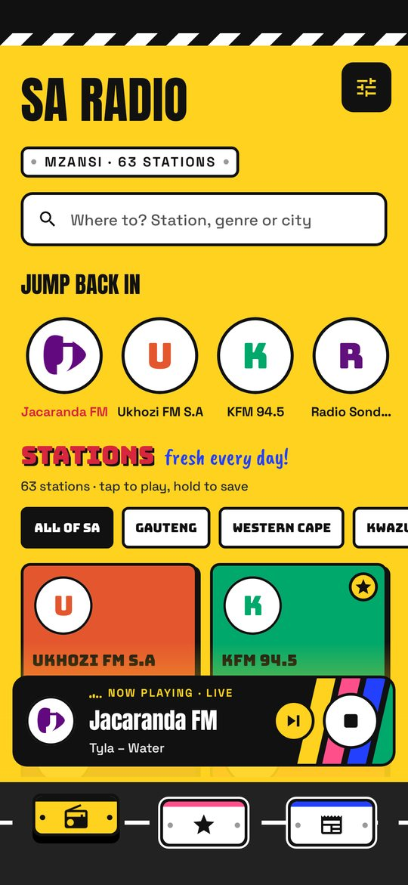
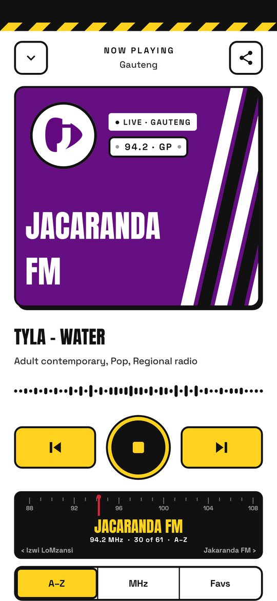
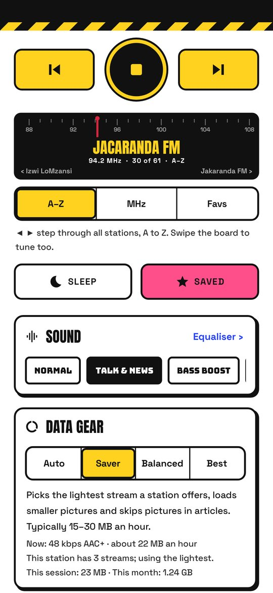
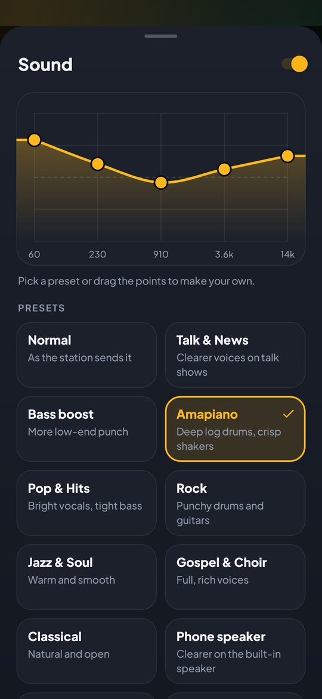
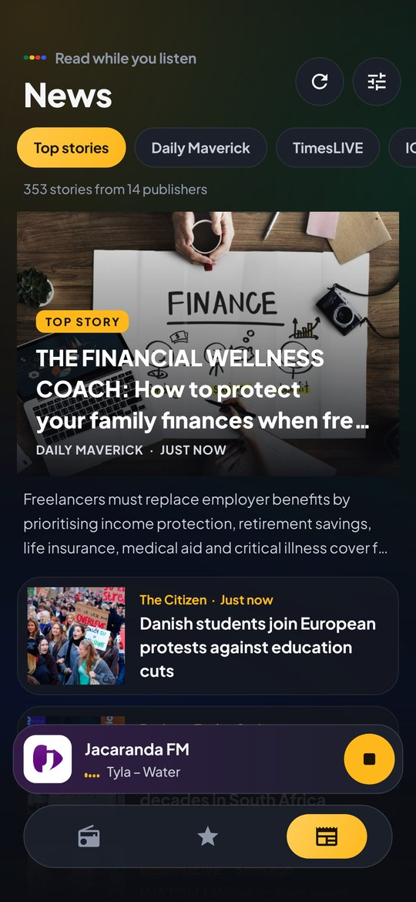
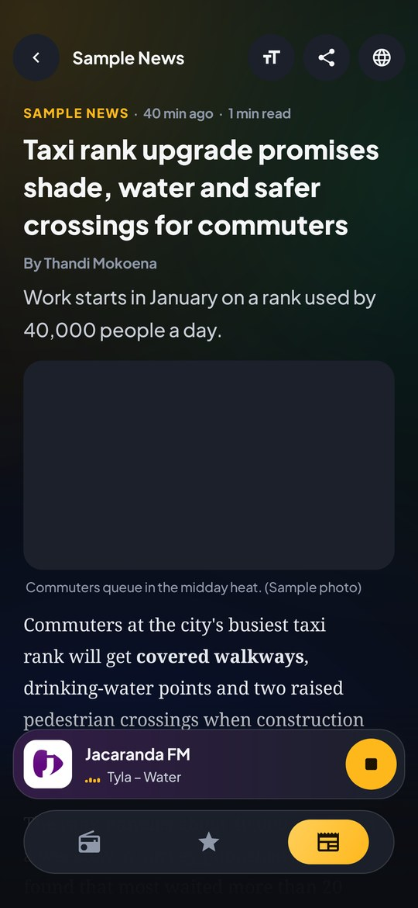
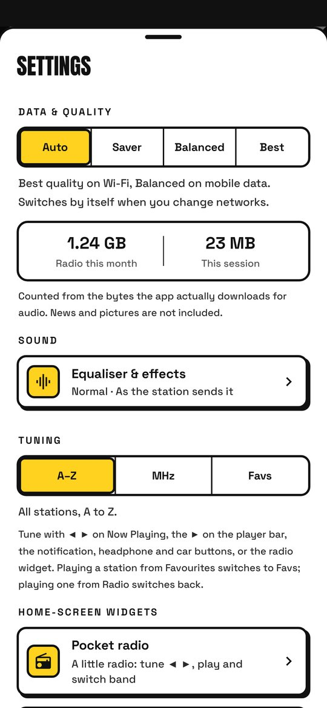
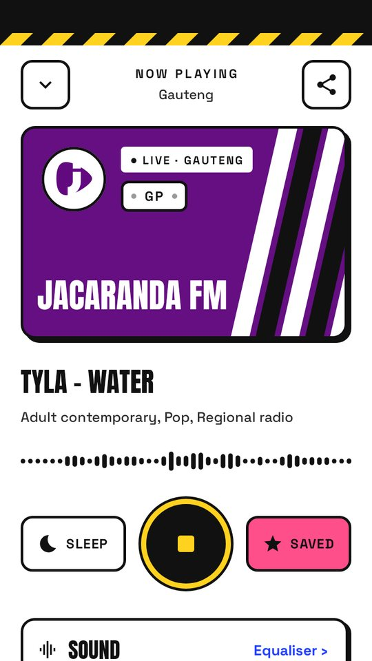

# SA Radio 3.1

South African radio and news for Android. This is the source of the SA Radio app, rebuilt from the
2.0 APK and redesigned. See [REVIEW.md](REVIEW.md) for what was wrong with 2.0 and what changed.

| Home | Now Playing | Sound & data on the player | Equalizer |
| --- | --- | --- | --- |
|  |  |  |  |

| News | Ad-free reader | Settings | Small phone (360×640 dp) |
| --- | --- | --- | --- |
|  |  |  |  |

## What it does

- **Radio:** about 190 South African stations from the community directory at radio-browser.info,
  with search, provinces, favourites, recently played, and your own stream links.
- **Sound:** a real equalizer (12 presets such as Talk & News, Amapiano, Phone speaker and Late
  night, plus a curve you can drag), bass boost, surround and loudness. Uses the phone's own audio
  effects, so a few phones that reserve them for their own sound settings can't use it.
- **Data & quality:** Auto, Saver, Balanced or Best. Picks the lighter or better stream when a
  station broadcasts more than one, sets the buffer depth, and trims picture downloads. Shows the
  stream's bitrate, roughly how many MB an hour it uses, and the radio data used this session and
  this month.
- **News without the clutter:** headlines from 16 South African publishers. Stories open in an
  ad-free reader that downloads only the article's text and pictures and draws them in the app's
  own design, with adjustable text size. If a page isn't a normal article, the original page opens
  with ad networks and trackers blocked.
- **Visualiser** driven by the actual audio, a sleep timer that fades out, and lock-screen and
  notification controls.

## Install

Download the latest `SA-Radio-3.x.apk`, open it on the phone and allow installing from that source.
3.1 installs over 3.0 directly.

The app is signed with a new key, so **uninstall SA Radio 2.0 first** (Android refuses to install
an app over one signed with a different key). Favourites from 2.0 can't be carried over.

## Build

Plain Java, no AndroidX or other libraries. Needs JDK 17+ and the Android SDK (platform 36).

```sh
./gradlew assembleDebug                 # debug APK
./gradlew testDebugUnitTest             # unit tests (Robolectric)
./gradlew testDebugUnitTest -Plive=true # also: real stations, live feeds, screenshots in build/screenshots
./gradlew assembleRelease               # signed release, needs keystore.properties (below)
```

Release signing reads `sa-radio/keystore.properties`, which is git-ignored:

```properties
storeFile=/absolute/path/to/saradio-release.jks
storePassword=...
keyAlias=saradio
keyPassword=...
```

Keep the `.jks` file and its password safe: future updates must be signed with the same key, or
users will have to uninstall again.

## Code map

| File | What it does |
| --- | --- |
| `StreamPlayer` | Downloads MP3/AAC streams, reads ICY song titles, splits frames, decodes and plays |
| `RadioService` | Background playback, stream choice and fallback, data meter, notification, sleep timer |
| `DataMode` | The Auto / Saver / Balanced / Best rules |
| `AudioFx`, `EqPresets` | Equalizer and effects on the shared audio session; presets as frequency curves |
| `Spectrum`, `BarsView` | Audio analysis for the visualiser, kept in step with the speaker |
| `StationRepo`, `NewsRepo` | Station directory and news feeds |
| `Extractor`, `Article`, `ArticleView`, `assets/reader/` | The ad-free reader: download a story's HTML, extract it with Readability, draw it |
| `AdBlock` | Ad and tracker blocking for the original-page fallback |
| `MainActivity`, `NowPlaying`, `Panels`, `Sheet` | Screens and bottom sheets |
| `Ui`, `LogoView`, `NavBar`, `Segmented`, `EqCurveView`, `BackdropView` | Design system and custom views |

`tools/reader-check/` re-tests the reader against live stories from every feed.

Third-party: Plus Jakarta Sans (SIL Open Font License 1.1); Mozilla Readability 0.6.0
(Apache License 2.0, `assets/reader/readability.js`).
