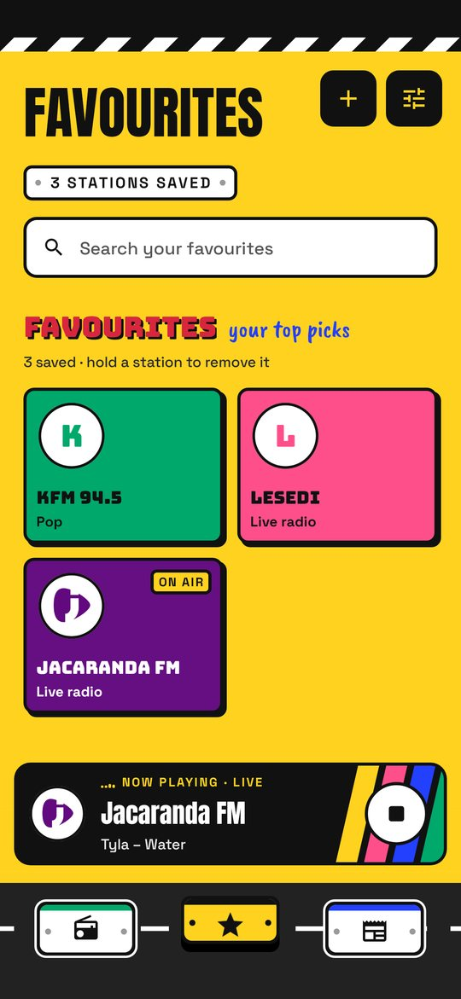
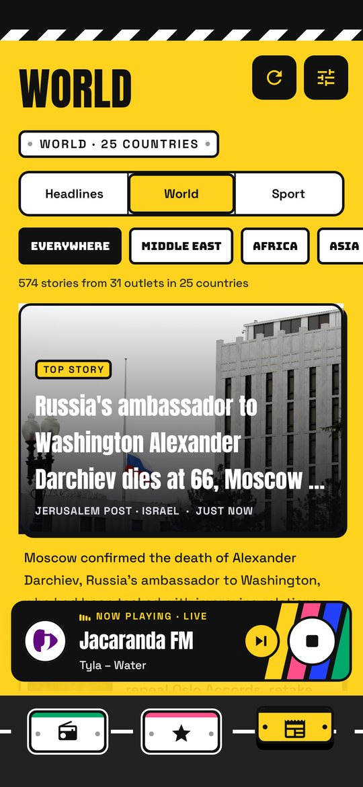
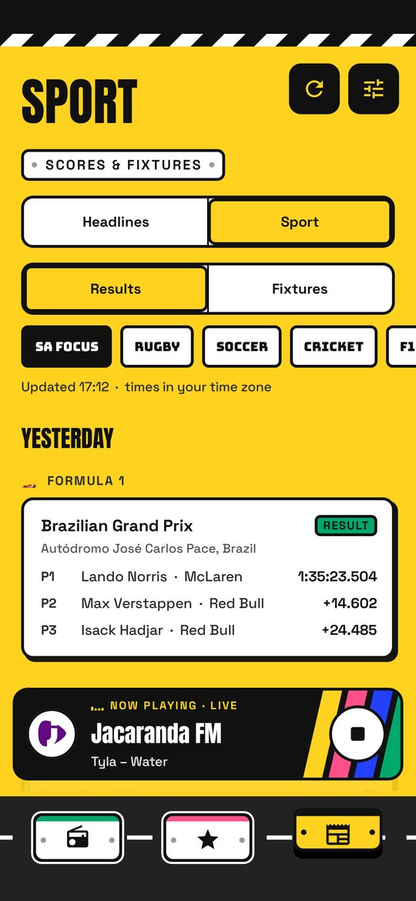
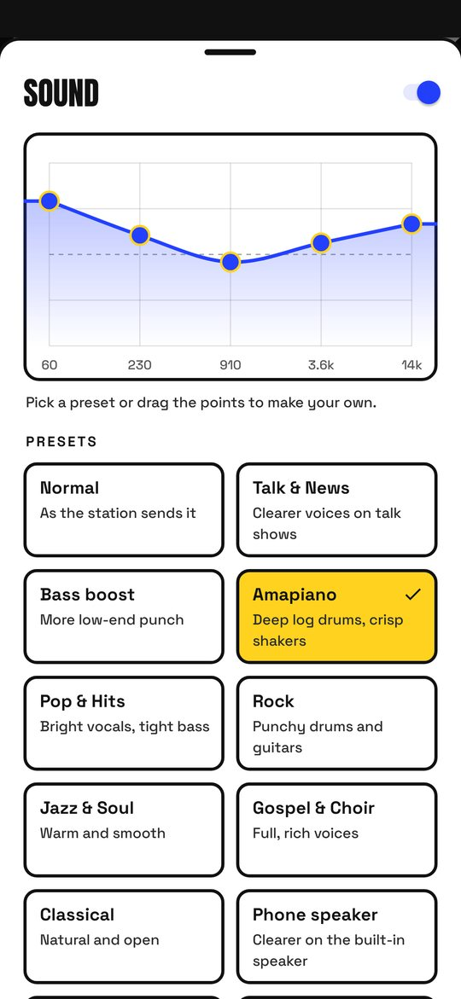
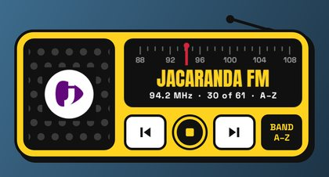
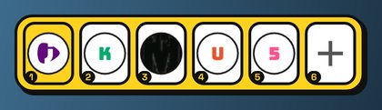
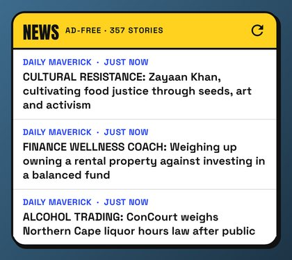
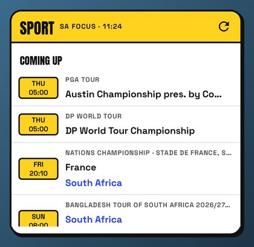
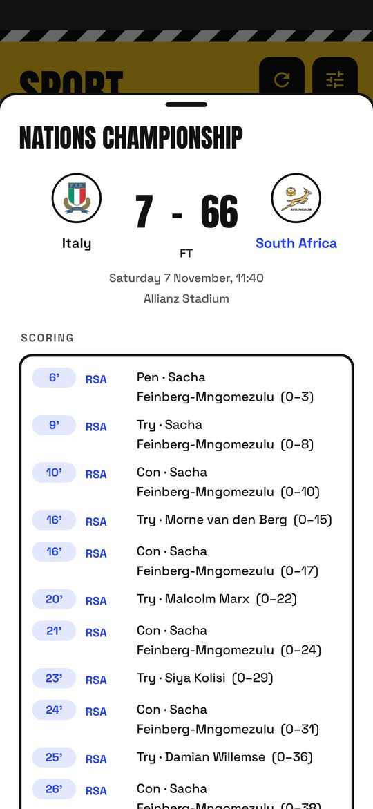

# SA Radio 4.2

South African radio and news for Android. This is the source of the SA Radio app, rebuilt from the
2.0 APK and redesigned. See [REVIEW.md](REVIEW.md) for what was wrong with 2.0 and what changed.

4.0 has the "Number Plate" design: taxi-rank yellow, black outlines, minibus livery stripes and a
bottom bar of number plates on a road. Stations are painted signs in each station's own colour
with its logo.

| Stations | Favourites | Now Playing | Sound & data gear |
| --- | --- | --- | --- |
|  |  |  |  |

| News | World (4.2) | Sport | Ad-free reader | Equaliser |
| --- | --- | --- | --- | --- |
|  |  |  |  |  |

Home-screen widgets (4.1):

| Pocket radio | Presets | Headlines | Read here | Scoreboard |
| --- | --- | --- | --- | --- |
|  |  |  |  |  |

| Settings | Match details | Small phone (360×640 dp) |
| --- | --- | --- |
|  |  |  |

## What it does

- **Radio:** about 190 South African stations from the community directory at radio-browser.info,
  with search, provinces, favourites, recently played, and your own stream links.
- **Sound:** a real equaliser (12 presets such as Talk & News, Amapiano, Phone speaker and Late
  night, plus a curve you can drag), bass boost, surround and loudness. Uses the phone's own audio
  effects, so a few phones that reserve them for their own sound settings can't use it.
- **Data & quality:** Auto, Saver, Balanced or Best. Picks the lighter or better stream when a
  station broadcasts more than one, sets the buffer depth, and trims picture downloads. Shows the
  stream's bitrate, roughly how many MB an hour it uses, and the radio data used this session and
  this month.
- **News without the clutter:** headlines from 16 South African publishers. Stories open in an
  ad-free reader that downloads only the article's text and pictures and draws them in the app's
  own design, with adjustable text size. If a page isn't a normal article, the original page opens
  with ad networks and trackers blocked.
- **World** (News tab → World): the same ad-free reader for 31 outlets in 25 countries, filtered by
  region (Middle East, Africa, Asia, Europe, Americas, Global). They were chosen from different
  countries and owners rather than one "neutral" source: Al Jazeera, Middle East Eye, Al-Monitor,
  Haaretz, Jerusalem Post, Saudi Gazette, Anadolu, Daily Sabah, AllAfrica, Africanews, Premium
  Times, Nation, The Hindu, NDTV, Dawn, SCMP, CGTN, CNA, Straits Times, Japan Times, MercoPress,
  Buenos Aires Times, CBC, DW, France 24, RFI, Euronews, BBC World, TASS, UN News and Global Voices.
  Each story is labelled with its outlet and country, and Settings lists who funds each outlet.
- **Sport** (News tab → Sport): results from the past week and fixtures for the next two, with live
  scores. Covers rugby (Springbok tests, URC, Currie Cup and European competitions), soccer
  (Betway Premiership, cups, Bafana Bafana, CAF and, on request, the big European leagues),
  cricket (Proteas and South African domestic), F1, golf and UFC. "SA focus" shows South African
  teams and players. Tap a match for line-ups, scorers, scorecards, race classifications or
  leaderboards. Data comes from ESPN's public score feeds and Jolpica (F1).
- **Tuning:** ◀ ▶ step to the previous or next station, like changing channel (not a sweep across
  the dial). The band decides which stations: **A–Z** (all stations alphabetically), **MHz** (all
  stations by FM frequency, then online-only stations A–Z) or **Favs** (your favourites, in the
  order you saved them). Playing from the Favourites tab switches to Favs; playing from Radio
  switches back. Tune from Now Playing (buttons, or swipe the station board), the ▶ on the player
  bar, the notification, headphone, Bluetooth and car buttons, or the radio widget. Frequencies come
  from the station's listing ("KFM 94.5", "Kaya 959") or, for a few big stations, a short table of
  their main frequency in their home city.
- **Home-screen widgets:**
  - **Pocket radio:** a little radio with an aerial, the station's logo on the speaker, a tuning
    dial with a needle, ◀ ▶, play/stop and a band switch.
  - **Presets:** your first six favourites as car-radio buttons; tap to play, tap the playing one to stop.
  - **Headlines:** the latest stories; tap one to read it in the app.
  - **Read here:** one story at a time, readable inside the widget. ◀ ▶ flip stories; "Read the
    whole story here" downloads just that page's text (automatic on Wi-Fi unless Data is on Saver).
  - **Scoreboard:** live games, fixtures and results for South African teams and players, refreshed
    every 2 minutes while a game is on (5 on Saver), otherwise hourly.

  Add them from Settings → Home-screen widgets, or by holding the home screen and choosing Widgets.
- **Visualiser** driven by the actual audio, a sleep timer that fades out, and lock-screen and
  notification controls.

## Install

Download the latest `SA-Radio-4.x.apk`, open it on the phone and allow installing from that source.
4.x installs straight over any 3.x or 4.x version, keeping favourites and settings.

The app is signed with a new key, so **uninstall SA Radio 2.0 first** (Android refuses to install
an app over one signed with a different key). Favourites from 2.0 can't be carried over.

## Build

Plain Java, no AndroidX or other libraries. Needs JDK 17+ and the Android SDK (platform 36).

```sh
./gradlew assembleDebug                 # debug APK
./gradlew testDebugUnitTest             # unit tests (Robolectric)
./gradlew testDebugUnitTest -Plive=true # also: real stations, live feeds, screenshots in build/screenshots
./gradlew assembleRelease               # signed release, needs keystore.properties (below)
```

Release signing reads `sa-radio/keystore.properties`, which is git-ignored:

```properties
storeFile=/absolute/path/to/saradio-release.jks
storePassword=...
keyAlias=saradio
keyPassword=...
```

Keep the `.jks` file and its password safe: future updates must be signed with the same key, or
users will have to uninstall again.

## Code map

| File | What it does |
| --- | --- |
| `StreamPlayer` | Downloads MP3/AAC streams, reads ICY song titles, splits frames, decodes and plays |
| `RadioService` | Background playback, stream choice and fallback, data meter, notification, sleep timer |
| `DataMode` | The Auto / Saver / Balanced / Best rules |
| `AudioFx`, `EqPresets` | Equaliser and effects on the shared audio session; presets as frequency curves |
| `Spectrum`, `BarsView` | Audio analysis for the visualiser, kept in step with the speaker |
| `StationRepo`, `NewsRepo` | Station directory and news feeds |
| `Extractor`, `Article`, `ArticleView`, `assets/reader/` | The ad-free reader: download a story's HTML, extract it with Readability, draw it |
| `AdBlock` | Ad and tracker blocking for the original-page fallback |
| `Sports`, `SportView`, `MatchSheet` | Fixtures, results and live scores; the Sport list; match details |
| `MainActivity`, `NowPlaying`, `Panels`, `Sheet` | Screens and bottom sheets |
| `Tuner`, `Freq`, `Dial` | Tuning order (A–Z, frequency, favourites), FM frequencies, the tuning dial |
| `RadioWidget`, `PresetsWidget`, `HeadlinesWidget`, `StoryWidget`, `SportWidget` | The home-screen widgets |
| `Widgets`, `WidgetListService`, `WidgetJobs`, `WidgetStore` | Widget plumbing: intents and pictures, list rows, background refreshes, saved scores and story text |
| `PlainText` | Pulls a story's text out of its page for the Read here widget (a widget can't run the reader's WebView) |
| `Ui`, `Livery`, `LogoView`, `NavBar`, `Segmented`, `EqCurveView` | Design system and custom views: colours and fonts, livery stripes, logo roundels and brand colours, the number-plate bar |

`tools/reader-check/` re-tests the reader against live stories from every feed.

Third-party: the fonts Anton, Bungee, Caveat Brush and Space Grotesk (all SIL Open Font License
1.1); Mozilla Readability 0.6.0
(Apache License 2.0, `assets/reader/readability.js`).
