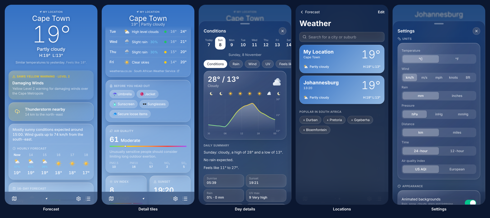
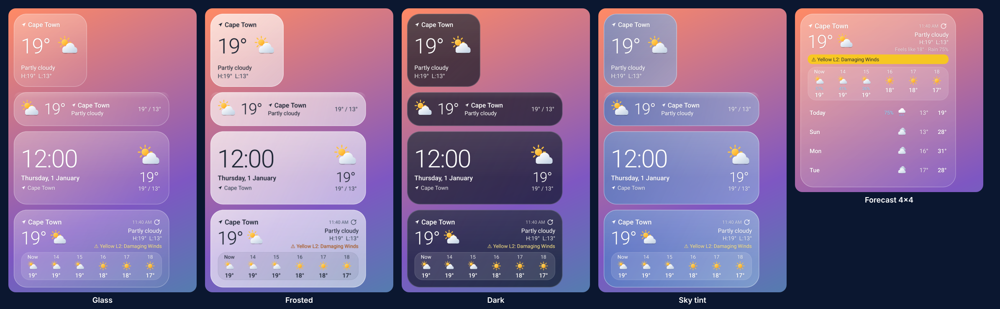

# Skyglass Weather

A modern weather app in an iPhone-style layout with frosted-glass cards, plus Samsung-style
home-screen widgets on Android. Made for South Africa: it shows the **South African Weather
Service** (SAWS, [weathersa.co.za](https://www.weathersa.co.za)) official forecast, warnings,
fire danger and thunderstorm tracking next to a detailed global forecast. Works worldwide.

- **iPhone:** web app at https://elrichjantjies-eng.github.io/lean-strong/weather/
- **Android (with widgets):** signed APK on the [Releases page](https://github.com/elrichjantjies-eng/lean-strong/releases?q=weather)

How to install, add widgets and turn on alerts: [docs/INSTALL.md](docs/INSTALL.md).



## Home-screen widgets (Android)

Five sizes, each in four glass styles (Glass, Frosted, Dark, Sky tint) with adjustable opacity.
Each widget can follow your location or a city of your choice, refreshes itself every 30 minutes,
shows SAWS warnings, and opens the app on that place when tapped.



| Widget             | Size | Shows                                                         |
| ------------------ | ---- | ------------------------------------------------------------- |
| Weather · small    | 2×2  | Temperature, icon, condition, high/low                        |
| Weather · wide     | 4×1  | One slim row: icon, temperature, place, condition, high/low   |
| Clock & weather    | 4×2  | Big clock and date beside the current weather                 |
| Weather · hourly   | 4×2  | Current conditions and the next 4–8 hours (follows the width) |
| Weather · forecast | 4×4  | Current conditions, the next hours and the next 2–7 days      |

## Features

**Forecast**

- Current conditions with an animated sky behind them: sun glow, drifting clouds, rain, snow,
  fog, twinkling stars and lightning, coloured for day, night and golden hour.
- iPhone-style header that shrinks to one line as you scroll; swipe between places.
- Hourly forecast for 24 hours with rain chances and sunrise/sunset markers, and a one-line
  summary ("Rain likely from 15:00 (60%). Wind gusts up to 55 km/h from the south-east.").
- 16-day forecast with temperature range bars.
- Rain in the next 3 hours, minute by minute ("Rain starting in about 25 min").
- "Compared with yesterday" and "feels like" explanations.
- Tap any day or tile for charts of temperature, rain, wind, UV, feels-like, humidity,
  air quality, visibility and pressure, hour by hour, with touch-to-read values.

**South African Weather Service**

- The official 7-day SAWS forecast from the nearest of ~300 SAWS stations.
- SAWS impact-based warnings (yellow/orange/red levels and advisories) for your exact location,
  with what to do; Android notifies you when a new one is issued.
- Thunderstorm cells from SAWS storm tracking: "Thunderstorm nearby: 14 km to the north-east",
  including where they're expected in 30 minutes.
- Fire danger index, tides and swell for coastal stations, moonrise and moonset.

**Details**

- Air quality (US AQI or European) with PM2.5, PM10, ozone, NO₂ and SO₂.
- UV index with "use sun protection from … to …".
- Wind compass with gusts and Beaufort description; pressure gauge with trend.
- Sunrise/sunset arc, daylight length and how it's changing; moon phase, illumination and the
  next full moon.
- Sea & surf for coastal places: waves, swell, period and sea temperature.
- Humidity with dew point, visibility, precipitation totals for the last and next 24 hours.
- "Before you head out": umbrella, jacket, sunscreen and so on.
- Today's outlook for running, braai, laundry, beach, stargazing, car wash, driving and watering
  the garden.

**Map**

- Animated rain radar, SAWS warning areas, storm cells (now and in 30 minutes) and today's highs
  for the main towns.

**App**

- My Location plus any number of saved places (search worldwide, popular SA cities one tap away).
- Units: °C/°F, km/h, m/s, mph, knots or Beaufort, mm/inches, hPa/inHg/mmHg, km/miles,
  24/12-hour clock.
- Works offline with the last forecast; pull down to refresh; share a forecast as text.
- Android: notifications for SAWS warnings, rain starting soon and a daily morning forecast.

## Data sources

| What                                                | From                                                       |
| --------------------------------------------------- | ---------------------------------------------------------- |
| Forecast, air quality, sea conditions, place search | [Open-Meteo](https://open-meteo.com) (free, no key, CC BY) |
| Official forecasts, warnings, storms, fire danger   | [SAWS](https://www.weathersa.co.za)                        |
| Place names for My Location                         | BigDataCloud                                               |
| Radar                                               | [RainViewer](https://www.rainviewer.com)                   |
| Map                                                 | OpenStreetMap, CARTO                                       |

SAWS's API doesn't allow other websites to read it from a browser. The Android app reads it live
through the phone's native networking. For the web app, the GitHub Pages workflow saves a copy
of the SAWS data next to the app every two hours (`scripts/saws-snapshot.mjs`).

## Development

Vite + React + TypeScript, Tailwind, Zustand, Leaflet, vite-plugin-pwa, and Capacitor for
Android. The widgets, background refresh and notifications are native Android code in
`android/app/src/main/java/com/skyglass/weather/widget/`.

```sh
npm ci
npm run dev            # local dev server
npm test               # unit tests (Vitest)
npm run e2e            # end-to-end tests at iPhone and Android sizes (Playwright, mocked network)
npm run lint           # ESLint + Prettier
npm run saws-snapshot  # fetch SAWS data into public/saws/ so the web app has it locally
npm run stations       # refresh the bundled SAWS station list
npm run icons          # re-render the app icon, Android launcher icons and splash
npm run android:icons  # regenerate the widget/notification icons from src/icons/defs.ts
```

The weather icons are defined once, as shapes, in `src/icons/defs.ts`; the app draws them as SVG
and `npm run android:icons` turns the same shapes into Android vector drawables for the widgets.

### Releasing

- **Web app:** every push to `main` builds and deploys to GitHub Pages together with
  Lean & Strong (`.github/workflows/pages.yml`).
- **Android:** bump `version` in `weather/package.json`, commit, then push a tag such as
  `weather-v1.0.1`. `.github/workflows/weather-android.yml` builds a signed APK with the same
  signing key as Lean & Strong and publishes a GitHub Release (never marked "latest", so the
  Lean & Strong download link keeps working).
- **Local Android build** (optional): JDK 21 and the Android SDK, plus
  `android/keystore.properties` for a signed build, then `npm run android:apk`.
